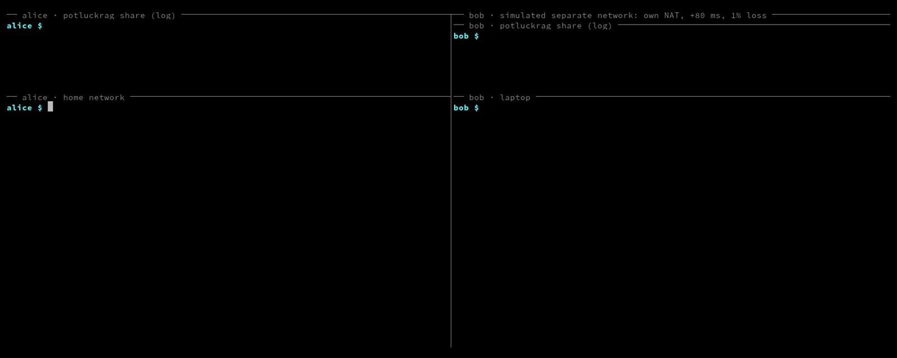

# PotluckRAG

[](https://github.com/jtxmp/potluckrag/actions/workflows/test.yml)
[](https://www.npmjs.com/package/potluckrag)
[](LICENSE)
[](package.json)

PotluckRAG is a CLI for retrieval-augmented question answering across documents stored on several machines. Each member indexes their own folders locally. A question is sent over [Hyperswarm](https://github.com/holepunchto/hyperswarm) to every team member, each member returns matching passages from its own index, and the asker's model answers with citations.

It uses the same identity and `team.json` format as [PotluckLLM](https://github.com/jtxmp/potluckllm).



*Alice (host network) shares a runbook. Bob (separate simulated network: own NAT, 80 ms delay, 1% loss, via `scripts/simnet.sh`) asks a question. The answer cites alice's file, and `potluckrag log` on alice's machine lists the passages bob received. Real output from `nomic-embed-text:v1.5` and `llama3.2:3b`. Reproduce with `vhs demo/demo.tape`.*

## Who it is for

- Small teams whose notes, specs and runbooks are on members' own machines and should not be copied to a shared server.
- One person with documents on several machines.

Members must trust each other. A member who answers sees the question; a member who asks receives the matching passages.

## Requirements

- Node 22.13 or later
- An OpenAI-compatible server for embeddings and chat, such as [Ollama](https://ollama.com):

```sh
ollama pull nomic-embed-text
ollama pull llama3.2:3b
```

## Quickstart

```sh
pnpm add -g potluckrag      # or: npm install -g potluckrag
```

1. Each member prints their public key and sends it to the team owner:

   ```sh
   potluckrag id
   ```

2. The owner creates the team file and sends `team.json` to each member over a private channel:

   ```sh
   potluckrag team init my-team --member alice
   potluckrag team add bob <bob's public key>
   ```

3. Each member shares folders and leaves the process running:

   ```sh
   potluckrag share ~/notes ~/specs
   ```

4. Any member asks:

   ```sh
   potluckrag ask "How do we roll back a release?"
   ```

   Output: the streamed answer, the sources (`[1] alice:notes/runbook.md#L3-12`) and how many members answered.

To run the whole path on one machine with a fake model and sample notes, without installing:

```sh
npx potluckrag try
```

## Commands

| Command | Description |
|---|---|
| `try` | Two members, sample notes and a fake model in one process, over the public DHT |
| `id` | Print your public key; create it on first run |
| `team init <team-name> [--member <name>]` | Create a team file with you as the first member |
| `team add <name> <public-key>` | Add a member to the team file |
| `share <folder>...` | Index and watch the folders; answer members' searches |
| `ask <question>` | Search all members and print a cited answer |
| `status` | Connected members, index sizes, embedding models |
| `log` | Passages you sent, to whom, and when |

## Options

| Option | Used by | Default |
|---|---|---|
| `--team <file>` | `team`, `share` | `./team.json` |
| `--port <n>` | `share`, `ask`, `status` | `11600` |
| `--embed-url <url>` | `share` | `http://127.0.0.1:11434` |
| `--embed-model <name>` | `share` | `nomic-embed-text` |
| `--chat-url <url>` | `ask` | `http://127.0.0.1:11434` |
| `--chat-model <name>` | `ask` | `llama3.2:3b` |
| `-k <n>` | `ask`: passages per answer, max 20 | `8` |
| `--deadline <s>` | `share`: time to wait for members | `3` |
| `--json` | `ask`: print passages as JSON, no answer | off |
| `--no-watch` | `share`: index once | off |

| Environment variable | Effect |
|---|---|
| `POTLUCKRAG_API_KEY` | Local endpoint requires `Authorization: Bearer <key>` |
| `POTLUCKRAG_CHAT_KEY` | Sent as the API key to `--chat-url` |

`--chat-url http://127.0.0.1:11500` uses a model shared through PotluckLLM's `potluck use`.

## How it works

```
 asker                                       each member
 ┌──────────────────────────────┐          ┌──────────────────────────────────┐
 │ potluckrag ask               │          │ potluckrag share                 │
 │   │ http 127.0.0.1:11600      │          │   watch -> chunk -> embed        │
 │   ▼                          │  search  │   SQLite: text, vectors, FTS5    │
 │ potluckrag share (local)     ├─────────▶│   hybrid search                  │
 │   own hits + members' hits   │◀─────────┤   passages, no scores            │
 │   re-ranked with own model   │   hits   │   audit log                      │
 │   ▼                          │          └──────────────────────────────────┘
 │ chat model, [n] citations    │    Hyperswarm topic from team.json,
 └──────────────────────────────┘    Noise-encrypted, key allow-list
```

- **Index:** text, Markdown and code files are split at headings and paragraphs into passages of at most 1,600 characters. A file is re-embedded only when its hash changes. Passages, vectors and an FTS5 index are stored in `~/.potluckrag/index.db` (`node:sqlite`). Vectors are held in memory for search.
- **Search per member:** vector similarity and BM25, merged with reciprocal rank fusion.
- **Fan-out:** the question goes to all connected members. The asker waits until all answer or `--deadline` passes.
- **Cross-member ranking:** members send passages without scores. The asker embeds the passages with its own model and ranks them against the question, since scores from different indexes and models are not comparable.
- **Answer:** passages go to the chat model as numbered, fenced sources. The model is instructed to answer only from them and cite `[n]`.
- **Connections:** Ed25519 identity in `~/.potluck/`, random topic in `team.json`, HyperDHT hole punching, firewall that drops keys not in `team.json`. Each member re-runs the topic lookup with backoff (5 s to 60 s) while any team member is not connected.

## Data sent

| Data | Recipient |
|---|---|
| Question | Every connected member |
| Matching passages: max 20 per question, 2,000 characters each, with root-relative path and line range | The member who asked |
| Question and passages in the prompt | The server at `--chat-url` |
| Embeddings, whole files, absolute paths, unshared files | Nobody |

Never indexed: hidden files and folders, `.env*`, `*.pem`, `*.key`, `*.p12`, `*.pfx`, `id_rsa*`, `credentials.json`, `secrets.*`, databases, `node_modules`, build output. Add patterns in `.potluckragignore` at the root of a shared folder.

## Security

- Connections from keys not in `team.json` are closed before any data flows.
- Each member answers at most 10 searches per member per 10 s and 4 concurrently, and logs every passage sent (`potluckrag log`). This limits and records bulk copying; it does not prevent it.
- Incoming hits are validated field by field. Invalid hits, and paths or titles with control characters, are dropped. Control characters are stripped from answers before printing.
- Symlinks that resolve outside a shared folder are not indexed.
- The local endpoint binds to 127.0.0.1 and rejects requests with an `Origin` header, a foreign `Host` header or a non-JSON body.
- Passages may contain prompt injection. The answer step has no tools; verify answers against the sources.
- Logs contain events, timings and root-relative paths, never questions, passages or answers.

Threat model with the test for each control: [docs/threat-model.md](docs/threat-model.md). Reporting: [SECURITY.md](SECURITY.md).

## Measurements

Measured 2026-10-23, i7-11600H, Node 22.22.2, Ollama 0.35.1, `nomic-embed-text:v1.5`.

**Retrieval quality.** [`eval/`](eval/) splits 20 Holepunch READMEs across three members and asks 28 questions with known source files.

| Mode | Recall@5 | MRR@5 |
|---|---|---|
| One central index | 0.929 | 0.848 |
| Federated, re-ranked by asker (PotluckRAG) | 0.893 | 0.798 |
| Federated, members' lists interleaved | 0.821 | 0.528 |

Central minus federated: recall@5 +0.036 (95% bootstrap interval -0.036 to +0.125), MRR@5 +0.051 (-0.071 to +0.176). n is small, there is one corpus and one model, and the questions were written by the author. See [eval/README.md](eval/README.md).

**Vector search**, one member, 768 dimensions ([spike/RESULTS.md](spike/RESULTS.md)):

| Passages | Median search | Vector memory |
|---|---|---|
| 10,000 | 8 ms | 30 MiB |
| 50,000 | 39 ms | 147 MiB |
| 100,000 | 78 ms | 293 MiB |

**Connection and latency**, two members on one machine over the public DHT: connected in a median of 4.3 s (3 runs). A search across both took 108 ms; `ask` with a `llama3.2:3b` answer took 5.1 s (one run, RTX 3050 Ti Laptop GPU). Not measured across separate networks.

## Limits

- Offline members cannot answer; nothing is cached on other machines.
- Text, Markdown and code only. No PDF or Word.
- Vector search is a full scan; time and memory grow linearly with passages.
- While a member is offline, the others repeat the DHT lookup once a minute.
- Small chat models can cite the wrong `[n]`, and `llama3.2:3b` sometimes answered with only `[1]` (2 of 4 demo recordings; not reproduced in 24 scripted runs). The printed source list is correct in both cases.
- `search_query:` / `search_document:` prefixes for `nomic-embed-text` are not added.
- Tests pass on Linux and macOS in CI. Manual runs with Ollama were on Linux only. Windows is untested.
- No relay fallback; networks that block hole punching cannot connect.

## Development

```sh
pnpm install
pnpm test                                          # local DHT testnet and fake model; no GPU or internet
node bin/potluckrag.js try
node --no-warnings eval/run.js --model nomic-embed-text:v1.5   # needs Ollama
node eval/compare.js eval/results/<file>.json      # bootstrap interval between modes
git config core.hooksPath .githooks                # gitleaks pre-commit scan
```

## Contributing

Open issues are the roadmap; [`good first issue`](https://github.com/jtxmp/potluckrag/labels/good%20first%20issue) marks small ones. [CONTRIBUTING.md](CONTRIBUTING.md) has setup, a code map and the house rules. Questions go in [Discussions](https://github.com/jtxmp/potluckrag/discussions).

## License

MIT. The files in `eval/corpus/` are third-party documentation under their own licenses; see [eval/corpus/SOURCES.md](eval/corpus/SOURCES.md).
